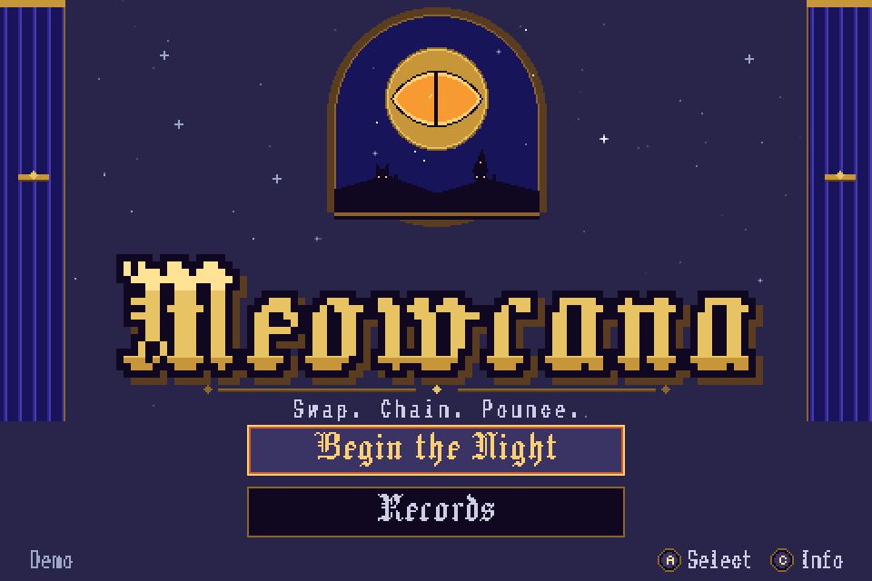
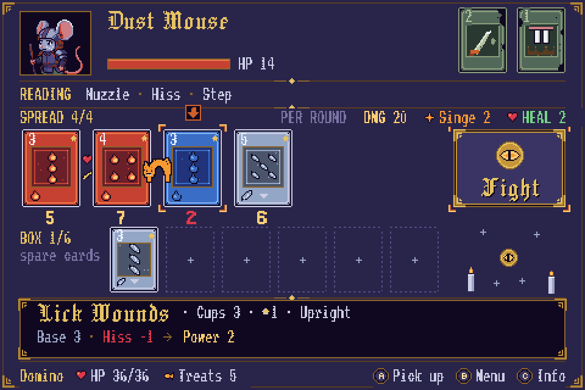
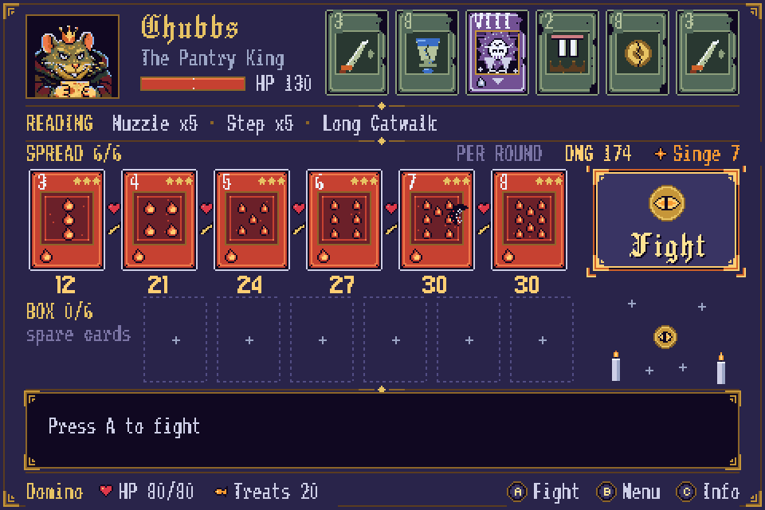
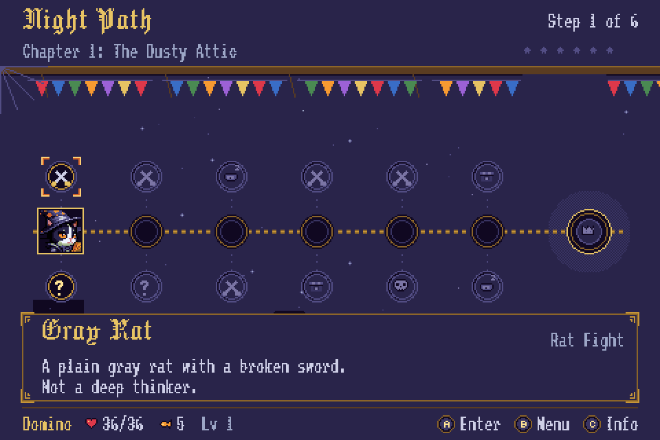
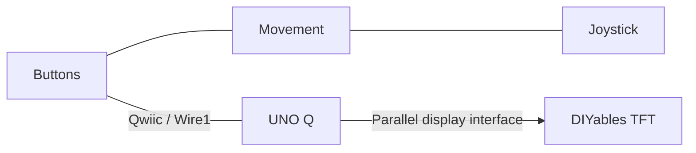
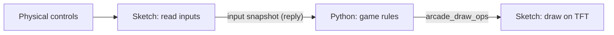
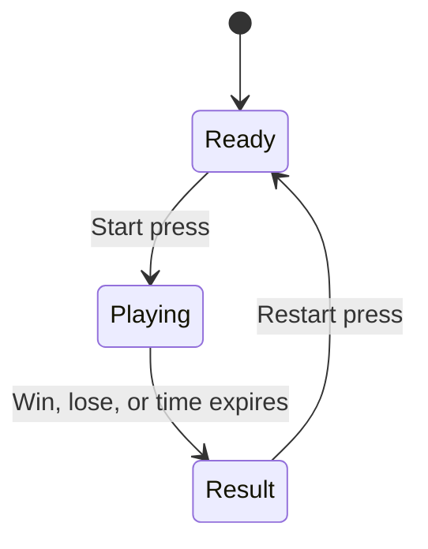
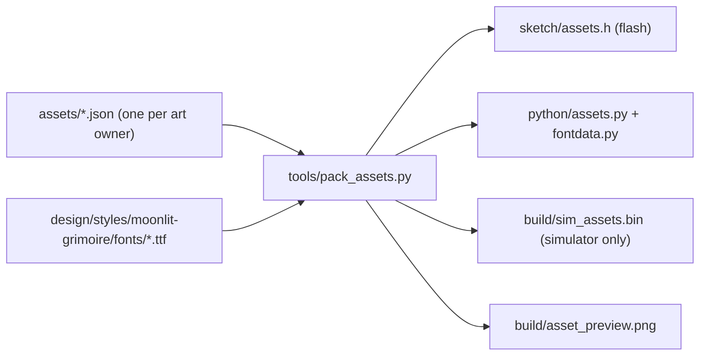

# Meowcana: Swap. Chain. Pounce.

[Game](#meowcana) · [How to play](#how-to-play) · [Controls](#controls) · [Run it](#run-it) · [Architecture](docs/architecture.md) · [Credits](docs/credits.md) · [Starter and platform guide](#starter-and-platform-guide) · [All tracks](../README.md)

## Meowcana

Meowcana is a pixel-art tarot roguelike for the UNO Q console (480×320 TFT, joystick, A/B/C). It is Eclipse Night in Wickton and the 22 Major Arcana have been stolen. You are Domino, an apprentice-seer tuxedo cat, with Zero, a ghost kitten, at your side. You don't swing a sword: you arrange a Spread of tarot cards, and the way neighboring cards read each other decides the fight.

**Demo video (60 s, silent):** [docs/media/meowcana_demo.mp4](docs/media/meowcana_demo.mp4)

| Title | Spread | Boss |
| --- | --- | --- |
|  |  |  |



### How to play

- **Swap**: pick up a card and drop it on another slot; the two swap seats. Cards sit in a Spread (and spare cards in the Box). Live numbers show what each slot will do before you commit.
- **Chain**: neighbors form readings. Same element is a Nuzzle (+2 Power), friends are a Tail Tap (+1), opposites Hiss (-1). Counting up makes a Step (+2); three in a row is a Catwalk (the last card plays twice). Reversed cards play mischief tricks. Cards play left to right, the rat answers, and the chain grows. See [`docs/story-and-tutorial.md`](docs/story-and-tutorial.md) for the lesson script.
- **Pounce**: press A on **Fight**. The whole battle is simulated up front and then played back with animation, so press A to speed it up or B to skip to the result. Win to pick 1 of 3 prize cards, Treats, and XP.

Each Night Path step offers a choice: Rat Fight, Elite, Spots' Stall, Encounter, Cat Bed or Cardboard Box. Lose and a bell goes dark (Nine Bells); you wake in the Moonnap Parlor and try again.

### Controls

The footer always shows what the buttons do right now.

| Control | Meaning |
| --- | --- |
| Joystick | Move the cursor (main axis wins; hold to repeat) |
| A | **Do**: the only button that commits (pick up, drop, Fight, buy, advance dialogue) |
| B | **Back**: never commits an irreversible action; backs out of a held card or moves the cursor to the exit button |
| C | **Info**: explains the highlighted card or item, never changes anything |
| A during a battle | Faster playback |
| B during a battle | Skip to the result |

### Demo scope

1. **Tutorial** ("Learn to Play", 27 guided steps): Zero teaches three lessons through three scripted battles (cards go left to right; neighbors matter; counting up, Catwalk and Reversed cards). Or **Skip Tutorial** for Fate's Draft and a one-page How to Play.
2. **Chapter 1: The Dusty Attic**: a Night Path of 6 steps plus the boss, with Sir Flea and Dog-Ear as elites, level-ups, Charms, Stars, merging, Treats and a stall.
3. **Boss Chubbs, the Pantry King**: Bottomless Belly, then Still Hungry at half HP. Beat him for the Demo End card.

Saves (`run.json`, `profile.json`) are written at node boundaries. Scope details: [`docs/demo-plan.md`](docs/demo-plan.md).

### Run it

On the UNO Q (from `arcade/`, board connected over USB with `adb` on your path; the first compile needs Internet and takes several minutes):

```sh
python scripts/deploy.py                  # pack assets, build the ZIP, push, flash the sketch, start the game
python scripts/deploy.py --serial YOUR_UNO_Q_SERIAL --adb /path/to/adb   # several devices, or adb not on PATH
```

`make flash` does the same on macOS/Linux; see [Terminal commands](#terminal-commands). To use App Lab instead, see [section 2](#2-run-the-app-lab-starter).

On a PC, no hardware needed (Python 3 with Pillow; the simulator runs the real game against a fake Bridge and the device cost model):

```sh
python tools/pack_assets.py                                  # once, and after art changes
python tools/sim.py --game nla.flow:make --window            # interactive: arrows = stick, Z = A, X = B, C = C
python tools/sim.py --game nla.flow:make --keys "1.0s,A,R,R,A,2.0s" --shots build/shots/   # scripted + screenshots
python tools/flow_play.py tutorial --shots build/shots/      # autopilot: tutorial | skip | boss | death
python -m unittest discover -s tests                         # rules tests
```

### Play on PC

The same game also runs in a Windows window with mouse and sound; the board build is unchanged (the PC code lives in `pc/`, and `nla.sfx` is a no-op on the board).

```sh
pc\Meowcana.bat                      # double-click it, or use the Meowcana shortcut on the Desktop
python pc/play.py --scale 3 --mute   # options: --fullscreen, --data DIR, --seed N
```

Needs Python 3 with `pygame-ce` and `Pillow` (the .bat installs them if they are missing). The window is 960x640 (integer scaling, F11 fullscreen), the game runs at 30 fps without the device cost throttling, and saves go to `%APPDATA%\Meowcana\` (with `settings.json` for volume, and `game.log` / `crash.log` if something goes wrong).

| Input | Action |
| --- | --- |
| Left click / Enter, Space | Confirm: select, pick up, drop (drag and drop works on the Spread), Fight |
| Right click / Backspace | Back: cancel, close, skip a battle; on Path and Spread (footer says `Right-click Menu`) it opens the pause Menu |
| I, Tab / middle click | Info (also click the `[I] Info` hint at the bottom) |
| Esc, M | pause Menu; inside a dialogue, Info page or the Menu itself it acts like Back (never skips a battle) |
| Mouse move, wheel / arrows, WASD | move the cursor |
| Battle | click the speed hint, Space or F = 1x/2x/4x; right click or Backspace = Skip |
| F11, N, - / = | fullscreen, mute, volume |

Pointer and sound contract for scenes: [`docs/pc-version.md`](docs/pc-version.md). Sounds are synthesized by `pc/sfx/gen_sfx.py` into `pc/sfx/*.wav`.

Headless checks (SDL dummy drivers, virtual clock, mouse events synthesized at the real window pixels):

```sh
python pc/play.py --script "wait 1; move 240 247; click 240 247; wait 1; shot choice; scene; sfx" --shots build/shots/pc/
```

Commands: `move/click/right/middle X Y`, `wheel up|down`, `drag X1 Y1 X2 Y2`, `key NAME [secs]`, `wait S`, `shot NAME`, `scene`, `expect SceneName`, `sfx` (lists the sounds the mixer played), `size W H`. Coordinates are game pixels (480x320).

How it fits together (Linux and MCU split, Bridge protocol, rendering cost model): [`docs/architecture.md`](docs/architecture.md). Asset list: [`docs/assets.md`](docs/assets.md). Fonts, generated art and tools: [`docs/credits.md`](docs/credits.md).

---

# Starter and platform guide

The sections below are the original UNO Q arcade starter and platform notes that Meowcana is built on: connecting the console, App Lab, controls calibration, the drawing API, the asset pipeline, and the simulator.

[Pre-work](PREWORK.md) · [Arduino references](PREWORK.md#arduino-references) · [Terminal commands](#terminal-commands) · [Hardware reference](#hardware-reference)

Build a game with a clear objective, physical controls, an ending, and a restart. The console arrives **preassembled** with an Arduino UNO Q, Modulino Joystick, Buttons and Movement, a printed body, and the DIYables 3.5-inch TFT.

Start with the included control preview, then choose **App Lab** for direct drawing or **RetroArch** for a software-rendered libretro game. Both use the supplied screen.

Before connecting your kit, complete the [pre-work](PREWORK.md) (about 30 minutes).

## 1. Connect to the console

You need [Arduino App Lab](https://docs.arduino.cc/software/app-lab/), a data-capable USB-C cable, and the console's supplied power arrangement.

1. Connect the UNO Q to your computer and follow the [App Lab board connection guide](https://docs.arduino.cc/software/app-lab/configure/config/).
2. Keep the prepared board software and assembled wiring in place. Make sure the joystick and buttons move freely.
3. Get the display-controller setting and prepared app ZIP supplied with your console.

The controls use the UNO Q's Qwiic connector (`Wire1`). The TFT uses the UNO headers.



## 2. Run the App Lab starter

For a terminal workflow, use [`make flash` and `make monitor`](#terminal-commands) below, then continue with the control preview here.

The App Lab application is the **`arcade/` folder**. Use the prepared ZIP, or open a terminal in `arcade/` and run this with GNU Make and `zip` installed:

```sh
make package
```

Import `build/uno-q-arcade.zip` from this track folder. Without Make, create the archive from the same folder in a macOS/Linux terminal:

```sh
zip -r /tmp/uno-q-arcade.zip app.yaml python sketch -x '*/__pycache__/*' '*.pyc'
```

On Windows, ZIP `app.yaml`, `python/`, and `sketch/` with `app.yaml` at the archive root. Import it from **My Apps** in App Lab and select the UNO Q.

In the imported `sketch/sketch.ino`, match `ARCADE_TFT_HX8357D` to the supplied console setting: **`1` for HX8357D** (the default), **`0` for RM68140**. Run the app. The first run needs Internet access and several minutes to download and compile dependencies.

The TFT shows **Meowcana** (*Swap. Chain. Pounce.*), started by [`python/main.py`](python/main.py) (`nla.flow.make()`). The footer always shows what the buttons do:

| Control | Meaning |
| --- | --- |
| Joystick | Move the cursor |
| A | Do (the only button that commits) |
| B | Back |
| C | Info (never changes anything) |
| Missing module | `Paused` with the names of the missing modules |

Move the stick and press A on **Learn to Play**. If the game shows `Paused`, have the named module's connection checked with power off, then restart the app. Saves go to `data/` next to `python/` on the board (`NLA_DATA_DIR` overrides it).

Edit the imported files in App Lab, then stop and run the app again. For a terminal-managed app, edit the local checkout and run `make flash` again. For an imported app, package and import local changes again. Export the app to preserve your code, controller selection, and calibration.

## 3. Adjust the controls

[`python/preview.py`](python/preview.py) contains the prepared defaults:

```python
DEAD_ZONE = 26
INVERT_X = False
INVERT_Y = True
MOVEMENT_ZERO_MG = (50, -75, 1034)
MOVEMENT_DEAD_ZONE_MG = 20
```

Set `INVERT_X` or `INVERT_Y` to match the mounted joystick. Adjust `DEAD_ZONE` only enough to keep its resting marker centered.

Movement should read near zero in the calibrated playing position. Tilt the console and return it to that position. A different mounting or playing position needs a new [Movement baseline](#calibrate-movement). These values describe acceleration changes, not angles in degrees.

Keep these settings in sync between the imported App Lab app and the board's RetroArch checkout.

### Calibrate Movement

Place the console in its usual playing position and keep it still. The preview subtracts a baseline from each acceleration axis and applies a dead zone. This centers game input; it does not calculate tilt angles.

Temporarily insert this code before `App.run(...)` in `python/main.py`, with `import json` and `import time` at the top:

```python
samples = []
for _ in range(100):
    sample = json.loads(Bridge.call("arcade_read_inputs"))
    assert sample["connected"] & 4, "Connect Movement and restart the app"
    samples.append([sample[key] for key in ("ax", "ay", "az")])
    time.sleep(0.05)
axes = list(zip(*samples))
assert all(max(axis) - min(axis) <= 40 for axis in axes), "Keep still and retry"
print("MOVEMENT_ZERO_MG =", tuple(round(sum(axis) / len(axis)) for axis in axes))
```

Copy the printed tuple to `MOVEMENT_ZERO_MG` in `python/preview.py`, remove the sampling code, and restart the app. Begin with `MOVEMENT_DEAD_ZONE_MG = 20`. The preview should settle near zero, change when tilted, and return near zero in the original position. Recalibrate if the module mounting or playing position changes.

Raw `arcade_read_inputs` acceleration still includes gravity. Keep the calibrated `preview.py` in both the exported App Lab app and the RetroArch checkout. RetroArch uses its joystick settings; tilt needs a separate game-specific mapping.

## 4. Choose your game workflow

### App Lab: draw directly on the TFT

[`python/main.py`](python/main.py) runs a game through [`python/engine.py`](python/engine.py). Each frame is one Bridge call: `arcade_draw_ops` carries that frame's packed drawing commands to the sketch and returns the next input snapshot. A game is any object with this shape (the demo's is `nla.flow.make()`):

```python
class Game:
    required = BUTTONS | JOYSTICK          # Runner pauses with a message if these are missing

    def update(self, controls, dt):         # rules; dt in seconds
        if controls.tapped(A): ...          # new press only; controls.down(A) while held
        self.x += controls.x * SPEED * dt   # stick -1..1, +x right, +y down; controls.tilt in mg

    def draw(self, screen, full):           # full=True: screen was just cleared, repaint all
        screen.sprite("player", self.x, self.y, 16, 16, RED)  # erases its old position itself
        screen.text(12, 8, f"Score {self.score:3d}", WHITE, BLACK, font=BODY)
```

`Screen` also provides `clear`, `fill_rect`, `rect`, `dotted_rect`, `fill_circle`, `circle`, `line`, `fill_triangle`, `text`, `text_center`, `text_right`, `measure`, `asset`, `blit`, `asset_region`, `card`, `stats`, and `hide`. The screen is 480×320 with the origin top-left, colors are RGB565 (`rgb(r, g, b)`). Text uses baked bitmap fonts (`BODY`, `TITLE`, `NUM`, `TINY`; see section 7). The runner targets 20 fps and logs the measured rate, RPC time, and bytes per frame every 5 seconds. Full-screen `clear()` is slow on this TFT: use it for scene changes and move small sprites between frames. Batches over 200 bytes are split into several calls, so heavy frames lower the frame rate.

The original preview's `arcade_draw_frame` method remains in the sketch for reference.



Put game state in your game object and draw with `Screen`; the sketch decodes the commands in `drawOps()`. To add a new drawing command, add its opcode to `Screen`, the sketch's `opSize()`/`drawOp()`, and `tools/sim.py` (then run `python tools/hosttest/parity.py`). Draw only the areas that change.

The input snapshot provides:

| Field | Meaning |
| --- | --- |
| `connected` | Bits `1=Buttons`, `2=Joystick`, `4=Movement` |
| `buttons` | Bits `1=A`, `2=B`, `4=C`, `8=joystick press` |
| `x`, `y` | Raw joystick axes, `-127` to `128` |
| `ax`, `ay`, `az` | Raw acceleration in mg, including gravity |
| `video` | Nonzero while a RetroArch stream owns the display |
| `epoch` | Changes when the sketch repaints the screen itself; the runner then requests a full redraw |

`engine.Controls` turns these into calibrated stick axes, held/new-press button bits, Movement deltas, and connection bits. The runner pauses the game while a `required` control is missing. Keep the input bounds and the sketch's 1.5-second display timeout when extending the starter.

A sketch-only game can reuse the same control and drawing routines, with its game rules in C++.

### RetroArch: run a libretro game

Follow the [RetroArch guide](retroarch/README.md) to open its menu and launch a software-rendered core on the TFT. You supply the core, game, and assets; none are bundled.

The bridge suits slow or mostly static games. A full-screen update takes seconds over this connection. Choose App Lab's direct drawing for games that depend on fast reactions. The launcher maps the joystick and buttons; Movement, touch, and audio are not mapped.

## 5. Build one complete round

For a first App Lab game, turn the marker into a target game:

1. Draw a fixed target and a short instruction on the TFT.
2. Move the marker with the joystick.
3. On a **new A press**, score when the marker is inside the target.
4. Show the result and accept a **new C press** to restart.

Put the round state and button-press edges in Python. Extend `drawFrame()` and its matching Bridge call to show the target, prompt, and result. Keep the first target fixed until the whole round works, then add your own rules or variation.



Track the previous button state so holding a button does not repeatedly start or restart. Use elapsed time for movement and timers. Keep positions within the visible area, pause if a required control is unavailable, and reset score, positions, and time for each new round.

Keep instructions and outcomes on the console screen. Use readable text, simple shapes, and a clear control map before adding artwork or animation. Touch is optional and needs [separate calibration](#optional-touch-input).

## 6. Make it easy to play again

Give the console to someone who has not used your game. They should be able to understand the objective, finish a round, and restart from the on-screen instructions. Use their playthrough to tune control sensitivity, text size, and difficulty.

Save the source, launch command, control map, controller setting, calibration, and asset credits. The [arcade rubric](../README.md#arcade-rubric) describes the complete result.

## 7. Pixel-art assets and fonts

Art and fonts live in MCU flash; Python only sends small ops (`screen.blit(asset, frame, x, y)` is 11 bytes). Bitmaps never cross Bridge at runtime.



**Manifests.** `python tools/pack_assets.py [--strict]` reads every `assets/*.json` (paths relative to `assets/` or `assets/raw/`):

```json
{"assets": [
  {"name": "card_back", "file": "ui/card_back.png"},
  {"name": "domino_idle", "glob": "characters/domino/idle_*.png", "fps": 4},
  {"name": "cards", "frames": ["a.png", "b.png"]},
  {"name": "faces", "sheet": "faces.png", "cell": [48, 64], "count": 96}
]}
```

`file` is a still, `glob`/`frames` an animation, `sheet` a frame-set (for example every card face, indexed by frame). `characters.json` uses the character artist's own schema and expands to `NAME`, `NAME_portrait` and `NAME_<animation>`. Each asset becomes `python/assets.py: NAME = Asset(id, w, h, frames, fps)`. Alpha under 128 is transparent; every opaque color must be RGB565-exact and all assets share one palette of at most 255 colors (the packer fails otherwise). An asset is stored as RLE6 (1-3 pixel runs in one byte, through a local palette of up to 63 colors) or, with at most 15 colors, as 4 bits per pixel, whichever is smaller. The packer prints a per-asset table and fails above 560 KB of flash. Limits: 255 assets, 65,535 frames each, 65,535 px per side.

**Drawing assets.** `blit(asset, frame, x, y, scale=1, flip=False, flip_y=False, tint=None, dim=False, bg=None)` draws once (`tint` paints every opaque pixel one color, `dim` darkens them; `bg` paints transparent pixels, `None` skips them with one window per run: slower, for small sprites). `asset(name, ...)` is the tracked variant that redraws only on change and erases its old position with `bg`. `asset_region(asset, frame, x, y, sx, sy, w, h)` draws a sub-rectangle (restore a background bitmap). `card(face, frame, x, y, rim, bg, ...)` draws a complete card (rim, ring, face, stars, gem) as one op.

**Fonts.** `text(x, y, msg, color, bg=None, font=BODY, scale=1)` with `BODY` (VT323 16 px), `TITLE` (Jacquard 24, mixed case only), `NUM` (Jersey 10 at 20 px) and `TINY` (Silkscreen 8), printable ASCII only. `(x, y)` is the cell's top-left; the baseline is `y + font_metrics(font)[1] * scale`. With `bg` the glyph cell is one opaque window of exactly `measure(msg, font, scale)` pixels (fast); without it only glyph pixels are drawn (slow). `text_center(y, msg, ..., cx=240)` and `text_right(x_right, y, msg, ...)` position by measured width.

Measured on the console (HX8357D, core 1.0.0): each Bridge call costs about 17 ms, a solid fill whose two color bytes are equal (`0x2929`) runs at about 770 kpx/s, other colors and bitmaps at about 180 kpx/s, and each command adds about 1.5 ms. The constants live in [`python/costmodel.py`](python/costmodel.py); `Screen.stats()` and the simulator use them. A frame should cost at most 45 ms on menus and 70 ms during animations.

### Faster TFT bus (optional, off by default)

The DIYables library has no native fast path for the UNO Q, so it drives the 8-bit parallel bus with `digitalWrite` (about 10 calls per data byte). With `ARCADE_FAST_BUS` set to 1 in [`sketch/sketch.ino`](sketch/sketch.ino), solid fills, bitmaps, glyph cells and cards write the bus through direct GPIO registers instead: two 256-entry lookup tables turn each byte into two `BSRR` writes, then WR toggles. Pin map (from the core's UNO Q overlay and the shield's wiring): TFT D0-D7 = PB4, PB8, PB3, PB0, PA12, PA11, PB1, PB2; RD/WR/CD/CS = PA4-PA7. The library still initializes the controller and draws circles, lines and triangles.

Turn it on with one line: `python scripts/deploy.py --fast-bus` (or change `#define ARCADE_FAST_BUS 0` to `1` in `sketch.ino`). The sketch then starts in mode 3, the slowest direct mode (about 6 nops between WR edges). `arcade_bus_mode(m)` switches paths at run time: 0 = library, 1/2/3 = direct with 0/2/6 nops. To compare them on the console run `python scripts/deploy.py --bench --fast-bus`, then `make logs`: `python/bench.py` shows a test pattern for 3 s per mode (look for noise or wrong colors, which mean the WR pulse is too short for that mode) and prints kpx/s for fills, text, and sprites per mode. Copy the numbers of the fastest clean mode into `python/costmodel.py` and set `FastBus::mode` at the end of `setup()` to it.

Verified without the board: the lookup tables, pin map, and WR/CD sequencing are checked by `python tools/hosttest/parity.py`, which runs the sketch's real code against a modeled bus (BSRR semantics, the pin map written out independently, an 8080 write decoder) and compares the picture with the simulator in all four modes. Not verified: that the pins and speeds actually behave on the board (output speed registers, WR pulse width against the HX8357D timing). The asset flash budget leaves room for code in the 768 KB user sketch partition.

## 8. Simulator

`tools/sim.py` runs the real Python game on your computer against a fake Bridge that decodes the exact op bytes the sketch receives, using the packed asset and font data, and charges every frame the device cost model. Run it from `arcade/` after `python tools/pack_assets.py`:

```sh
# Headless and deterministic: scripted input, screenshots, cost.csv
python tools/sim.py --game nla.flow:make --keys "1.0s,A,R,R,A,2.0s" --shots build/shots/ --every 0.5

# Interactive window at 2x: arrows = stick, Z = A, X = B, C = C, e = force full redraw, p = save screenshot
python tools/sim.py --game nla.flow:make --window
```

`--game module:attr` names a callable returning the game object (dotted modules under `python/` work). `--keys` is a comma list: `1.5s` waits, `A`/`B`/`C`/`S` tap a button or the stick press (0.1 s), `L`/`R`/`U`/`D` tap the stick, `R:0.5s` holds, `R+A:0.3s` combines, `EPOCH` makes the sketch "repaint" so the runner redraws everything, and `SHOT[:name]` saves a screenshot. The virtual clock advances by the estimated device time, so game timing matches a slow frame. The run prints a warning for every frame above 45 ms (70 ms while the game sets `busy = True`) and a summary; `cost.csv` has one row per frame (ms, RPC chunks, bytes, ops, fast/slow pixels).

Checks that need no hardware: `python tools/sim_selftest.py` (baked glyphs equal Pillow's rendering), `python tools/sim.py --game sim_selftest:Game --keys 0.3s --shots build/shots2/ --scale 2` (every op), and `python tools/hosttest/parity.py` (compiles the sketch's real op decoder on the host with `python -m ziglang`, from `pip install ziglang`, and compares its pixels with the simulator).

## Code map

| File | Role |
| --- | --- |
| [`python/main.py`](python/main.py) | Starts the game runner |
| [`python/engine.py`](python/engine.py) | Calibrated controls, batched drawing, frame loop, missing-control pause |
| [`python/nla/`](python/nla/) | The Meowcana game (`nla.flow.make()` is the entry point) |
| [`python/assets.py`](python/assets.py), [`python/fontdata.py`](python/fontdata.py) | Generated asset ids, sizes, frame counts, and font metrics |
| [`python/costmodel.py`](python/costmodel.py) | Device cost constants shared by `Screen.stats()` and the simulator |
| [`python/bench.py`](python/bench.py) | Board benchmark for the cost constants (`scripts/deploy.py --bench`) |
| [`python/preview.py`](python/preview.py) | Input bounds and shared control calibration |
| [`sketch/sketch.ino`](sketch/sketch.ino) | Modulino input, Bridge methods, and TFT drawing (`arcade_draw_ops`) |
| [`sketch/sketch.yaml`](sketch/sketch.yaml) | Pinned UNO Q core and Arduino libraries |
| [`sketch/assets.h`](sketch/assets.h) | Generated palette, compressed frames, and baked glyphs in flash |
| [`sketch/video_protocol.h`](sketch/video_protocol.h) | Small image tiles used by RetroArch |
| [`tools/`](tools/) | Asset packing (`pack_assets.py`), simulator (`sim.py`), and host checks, run on your computer |
| [`assets/`](assets/) | Asset manifests (`*.json`) and source PNGs |
| [`scripts/deploy.py`](scripts/deploy.py) | One-command deploy: pack assets, build the ZIP, push, flash |
| [`retroarch/`](retroarch/README.md) | Linux launcher and control mapping |

The controls and enclosure are based on the [Arduino UNO Q Arcade Bundle](https://projecthub.arduino.cc/Arduino_Genuino/uno-q-arcade-bundle-b272c5), with the [DIYables TFT shield](https://diyables.io/products/3.5-320x480-tft-lcd-color-touch-screen-shield-for-arduino-uno-mega) added as the console display.

## Terminal commands

After the board's initial setup, you can develop from a **macOS/Linux terminal** in `arcade/`. Install GNU Make, `zip`, and [Android SDK Platform-Tools](https://developer.android.com/tools/releases/platform-tools), with `adb` on your command path. The prepared UNO Q provides Python 3 and [Arduino App CLI](https://github.com/arduino/arduino-app-cli), which builds and runs both parts of the app.

```sh
make devices
make flash
make monitor
```

`make flash` copies this track's `app.yaml`, `python/`, and `sketch/` to `~/ArduinoApps/uno-q-arcade-cli` on the board, compiles and uploads the MCU sketch, and starts Python. The first run needs Internet access to download dependencies. Match the display controller and control calibration in your local source before flashing.

After editing local files, run `make flash` again. It replaces those source paths, including edits made to that copy in App Lab, while preserving the app's `data/`, `.env`, and dependency cache. Save game data under `data/`, outside the replaced source folders. Other App Lab projects are left in place.

| Command | Action |
| --- | --- |
| `make` | List available commands |
| `make devices` | List connected ADB devices |
| `make flash` | Deploy this track, upload its sketch, and start Python |
| `make monitor` | Open the MCU serial monitor |
| `make logs` | Follow Python output, including `print()` and errors |
| `make stop` | Stop this track's terminal-managed app |
| `make package` | Pack assets and create `build/uno-q-arcade.zip` for App Lab import |
| `python scripts/deploy.py` | Same as `make flash` without GNU Make or `zip` (works on Windows); `--bench` deploys the benchmark, `--logs` follows the log |
| `make build` | Compile only the MCU sketch locally with [Arduino CLI](https://arduino.github.io/arduino-cli/) |
| `make clean` | Remove this track's local ZIP and sketch build |

Use **Ctrl+C** to leave the monitor or logs; the app keeps running. Use `make stop` when finished. For Python game logic, keep `make logs` open in a second terminal.

With one USB device connected, no board selection is needed. If several are connected, use the serial from `make devices` on each board command:

```sh
make flash SERIAL=YOUR_UNO_Q_SERIAL
make monitor SERIAL=YOUR_UNO_Q_SERIAL
make logs SERIAL=YOUR_UNO_Q_SERIAL
make stop SERIAL=YOUR_UNO_Q_SERIAL
```

Only one App Lab app can run at a time. If another app is running, stop it in App Lab or use a board terminal before flashing:

```sh
adb -d shell
TMPDIR=/tmp arduino-app-cli app list
TMPDIR=/tmp arduino-app-cli app stop APP_ID
exit
```

Replace `APP_ID` with its ID from the list. With multiple devices, replace `adb -d shell` with `adb -s YOUR_UNO_Q_SERIAL shell`. Tool paths can be overridden with `ADB=...` or `ARDUINO_CLI=...`; local Arduino CLI is needed only for `make build`.

## Hardware reference

The console is supplied preassembled. Use this section when preparing or maintaining a unit; normal development starts with the software steps above.

### Display and wiring

The [DIYables 3.5-inch TFT shield](https://diyables.io/products/3.5-320x480-tft-lcd-color-touch-screen-shield-for-arduino-uno-mega) uses an 8-bit parallel display interface and resistive touch. The starter uses landscape **480×320** and defaults to **HX8357D**. Set `ARCADE_TFT_HX8357D` to `0` for an RM68140 unit. Older ILI9488 units need a different driver.

The vendor lists UNO/Mega support; UNO Q requires attention to its own electrical limits. With power disconnected, compare the shield signals and supply arrangement with the [UNO Q manual](https://docs.arduino.cc/tutorials/uno-q/user-manual/) and [pinout](https://docs.arduino.cc/resources/pinouts/ABX00162-full-pinout.pdf). UNO Q GPIO uses 3.3 V logic, and **A0 and A1 are not 5 V tolerant**. Resolve signal-level differences before powering the assembly.

| Pins | Shield function |
| --- | --- |
| D2–D9 | Display data; D6/D7 are also used by touch |
| A0 | Display read |
| A1 | Display write / touch Y+ |
| A2 | Display command-data / touch X− |
| A3 | Display chip select |
| A4 | Display reset |
| D10–D13 | Optional microSD interface |

Connect the Modulinos through **Qwiic / `Wire1`**, leaving the TFT pins dedicated to the shield. The starter uses Buttons at `0x3E`, Joystick at `0x2C`, and Movement at `0x6A`. Leave microSD unused for the starter.

### Board software

Use the MCU runtime matching the pinned Zephyr core in [`sketch.yaml`](sketch/sketch.yaml) (**1.0.0**, the version installed on the hackathon consoles' images). A sketch built for a different core uploads without errors but never registers its Bridge methods: Python then logs `method arcade_read_inputs not available`. Follow Arduino's [Zephyr migration instructions](https://support.arduino.cc/hc/en-us/articles/27251870677916-Migrating-to-Zephyr-core-0-55-0-on-UNO-Q) when preparing an older board. Keep the full dependency list in `sketch.yaml`.

Run the [Arcade starter](#2-run-the-app-lab-starter) with the fitted display controller selected. The title, control states, and marker should fit the screen. For display-only setup, the [DIYables library](https://github.com/DIYables/DIYables_TFT_Touch_Shield) includes `DrawShapes` and `ShowTextAndNumber` examples for each supported controller.

Supply the console with its controller setting, calibrated app, board connection details, and power arrangement. For RetroArch, also prepare the [Linux launcher](retroarch/README.md), core, content, and launch command.

### Optional touch input

The starter uses Modulinos for gameplay. To add touch, run the vendor's `TouchCalibration` example for the fitted controller and rotation, then use `TouchGetPoint` or `TouchButton`. Save the calibration, try the center and corners, and confirm release and drag behavior. Display and touch share pins, so preserve the library's pin-mode switching and analog-read assumptions.
