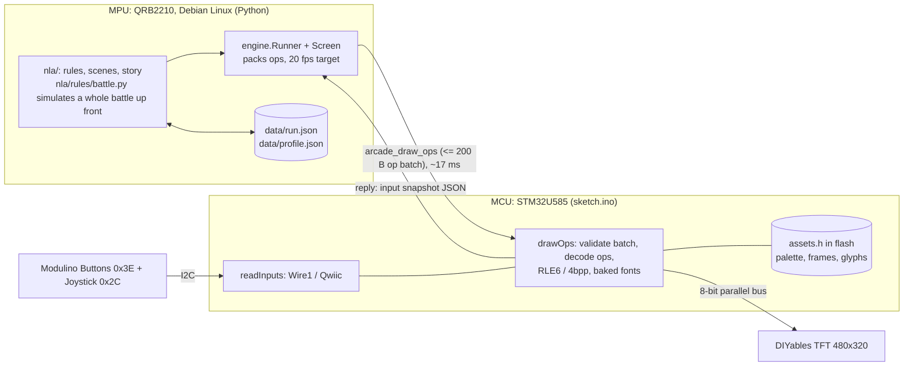
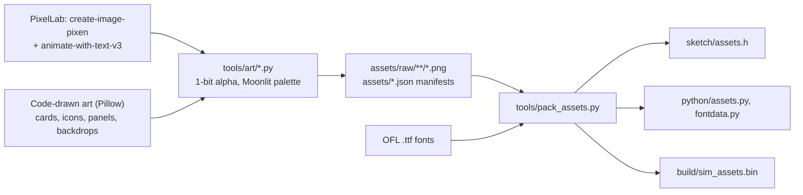

# Architecture: how Meowcana uses the UNO Q

Meowcana splits across both processors of the UNO Q, the way the board is designed to be used (see [`PREWORK.md`](../PREWORK.md): the QRB2210 MPU runs Debian Linux, the STM32U585 MCU runs Arduino sketches on Zephyr). Linux decides; the MCU touches hardware. Everything below cites the file the number or behavior comes from. Paths are relative to `arcade/`.



## Linux side (Python)

- **Entry point.** `python/main.py` starts the runner with `nla.flow.make()` (`README.md` "Code map"). `engine.Runner` (`python/engine.py`) targets `FPS = 20`, calls `game.update(controls, dt)` and `game.draw(screen, full)`, and logs measured fps, RPC time per frame and bytes every 5 seconds.
- **Rules are pure Python** with no engine imports (`python/nla/rules/`, contract in [`demo-plan.md`](demo-plan.md) section 5): cards, readings (`analyze`), enemies, run state, saves. 65 unit tests cover them (`tests/test_rules.py`, `python -m unittest discover -s tests`).
- **A whole battle is computed up front.** `rules/battle.py: simulate(run, enemy, seed)` returns a `BattleResult` holding the complete list of `Event`s plus the outcome. The Battle scene only plays that list back with animation, so speed-up (A) and skip (B) are just a faster or abandoned playback, and the same seed always gives the same fight.
- **Scenes** (`python/nla/scenes/`) are built by `nla/flow.py`, which wires them with `done` callbacks. Every scene draws only what changed unless `full=True` (see dirty rects below). All dialogue lives in `nla/story.py`.
- **Saves** are written by `rules/save.py` to a temporary file and moved into place with `os.replace`, so a power cut cannot leave a half-written file. Files are `run.json` (the current run) and `profile.json` (records, Nine Bells) in `data/` next to `python/` on the board; `NLA_DATA_DIR` overrides the folder (`nla/flow.py`). `scripts/deploy.py` and `make flash` preserve `data/` across updates.

## MCU side (STM32U585 sketch)

[`sketch/sketch.ino`](../sketch/sketch.ino) does only what needs the hardware:

- **Input.** `readInputs()` reads the Modulino Buttons (I2C address `0x3E`) and Joystick (`0x2C`) as raw 4-byte packets over `Wire1`, the Qwiic bus, and rejects short packets. Modulino Movement is read through the Modulino library when present but Meowcana does not require it (`required = BUTTONS | JOYSTICK`). The result is one JSON snapshot: `video`, `epoch`, `connected`, `buttons`, `x`, `y`, `ax`, `ay`, `az` (fields in `README.md` "The input snapshot provides").
- **TFT driver.** The DIYables 3.5" shield is driven over an 8-bit parallel bus (TFT D0-D7 = PB4, PB8, PB3, PB0, PA12, PA11, PB1, PB2; RD/WR/CD/CS = PA4-PA7, comment at the top of `sketch.ino`). By default pixels go through the DIYables library (about 10 `digitalWrite` calls per data byte, `README.md` "Faster TFT bus"). The optional direct-GPIO bus (`ARCADE_FAST_BUS`, default 0, `--fast-bus`) is implemented and host-tested but **not verified on hardware**, so the shipped build does not use it.
- **Flash-resident assets.** `sketch/assets.h` (generated by `tools/pack_assets.py`) holds the shared palette, every sprite and card face, and baked glyphs. At the last pack run: 115 assets, 465 frames, 49 of 255 palette colors, and **398,466 B of the 573,440 B (560 KB) budget** (art 388,091, frame table 1,864, palette 98, fonts 6,829). The sketch has a 768 KB partition (`README.md` "Faster TFT bus").
- **Decoding on the MCU.** Each frame is stored as RLE6 (one byte holds a 1-3 pixel run plus a local palette index; longer runs take two bytes; local palette up to 63 colors) or, for assets of at most 15 colors, packed 4 bits per pixel, whichever is smaller (`pack_assets.py` header). The sketch's `FrameReader` expands them into palette indices and then RGB565 while streaming into an address window.
- **Baked fonts.** Four 1-bit fonts, ASCII 32-126 plus a few extra glyphs: `BODY` VT323 16 px, `TITLE` Jacquard 24, `NUM` Jersey 10 at 20 px, `TINY` Silkscreen 8 (`pack_assets.py: FONTS`). No font file is shipped; Python only sends a string.
- **Op batching.** `drawOps()` receives a byte string of back-to-back ops, first walks it with `opSize()` to validate every length, and only then draws (`applyOps(..., draw=false)` then `true`), so a malformed batch draws nothing. It then returns a fresh input snapshot in the same reply.
- **Safety net.** If no frame arrives for 1.5 s, `loop()` repaints the "waiting" screen; the `epoch` counter in the snapshot tells Python to redraw everything afterwards.

## The Bridge RPC protocol

Python and the sketch talk through Arduino's RouterBridge. `setup()` registers these methods with `Bridge.provide_safe`:

| Method | Purpose |
| --- | --- |
| `arcade_draw_ops` | **The game's only per-frame call.** Argument: one packed op batch. Reply: the next input snapshot |
| `arcade_read_inputs` | Input snapshot only (calibration snippets, benchmarks, starter) |
| `arcade_draw_frame` | The original starter's preview frame, kept for reference |
| `arcade_bus_mode` | Select library or direct-GPIO bus path at run time (`0`-`3`) |
| `arcade_video_begin`, `_tile`, `_poll`, `_end` | RetroArch image stream, unused by Meowcana |

Ops (opcodes in `python/engine.py`, sizes in the sketch's `opSize()`): 1 clear (3 B), 2 fill_rect, 3 rect, 6 line and 11 dotted_rect (11 B each), 4 fill_circle and 5 circle (9 B), 7 text (header plus the string), 8 fill_triangle (15 B), 9 asset blit (11 B, 13 with tint), 10 asset_region (19 B), 12 whole card (18 B, 20 with tint). A sprite on screen is therefore 11 bytes however large its picture.

Why it is shaped this way:

- **Each RPC costs about 17 ms** (`python/costmodel.py: RPC_MS`, measured on the console). A call per op would exhaust a frame after two or three ops, so the runner batches every op of a frame into one byte string.
- **Requests are capped.** `MAX_CHUNK = 200` keeps each request under the 256-byte RPC limit (`engine.py`). A heavier frame is split into several `arcade_draw_ops` calls and costs 17 ms more per extra chunk.
- **Sprites live in MCU flash** because pushing pixels over RPC is hopeless: at 200 bytes and 17 ms per call, a raw RGB565 480x320 bitmap (307,200 B) would need 1,536 calls, about 26 s (arithmetic from those two constants). Python sends "draw asset N, frame F at (x, y)" and the MCU decodes from flash.
- **One RPC per frame returns the inputs.** Reading inputs with a second call would add another 17 ms, so `arcade_draw_ops` returns the snapshot. The runner calls `arcade_read_inputs` only for the first snapshot and after an error or a RetroArch hand-off (`engine.py` `Runner.step`).

## Rendering and the cost model

The bus is the bottleneck, not Python, so the game is written around a cost model (`python/costmodel.py`, same constants used by `Screen.stats()` and the simulator):

```
frame_ms = chunks * 17 + ops * 1.5 + runs * 0.06 + fast_px / 770 + slow_px / 180     (px in thousands)
```

A fill whose two RGB565 bytes are equal (for example `0x2929`) runs at about 770 kpx/s; any other fill, bitmap or glyph cell at about 180 kpx/s. Budgets: **45 ms** for menus and idle frames, **70 ms** while a scene sets `busy = True` (battle playback, transitions). A full-screen bitmap takes about 0.85 s (`demo-plan.md` section 2), so full redraws happen only on scene change, behind a transition.

Everything else is **dirty-rect rendering**: scenes draw with `full=False` and repaint only what moved (`nla/ui/app.py` Scene contract). Tracked sprites (`Screen.asset`) redraw only on change and erase their old position with a background color; `asset_region` restores a slice of a backdrop bitmap under something that moved; text with an opaque background is one window of exactly the measured width instead of per-pixel runs; a whole card (rim, ring, face, stars, gem) is one 18-byte op. Colors are chosen so large fills use the fast byte-equal case (the Moonlit palette's `night1` is `0x2929`).

## Simulator and parity tests

You can develop without the board:

- `tools/sim.py` runs the real game against a fake Bridge that decodes the exact op bytes into a 480x320 image using the packed assets, and charges each frame the device cost model, warning when a frame goes over 45/70 ms. Headless (`--keys`, `--shots`, `cost.csv`) or interactive (`--window`).
- `tools/flow_play.py {tutorial,skip,boss,death}` is an autopilot that plays full scenarios through the simulator and saves screenshots.
- `tools/sim_selftest.py` checks that baked glyphs equal Pillow's rendering and that every op round-trips.
- `tools/hosttest/parity.py` compiles the sketch's real op decoder on the host (C++ via `python -m ziglang`, with stub `Arduino.h`, `Wire.h`, and so on in `tools/hosttest/`) and compares its pixels with the simulator's. It reports 0 differing pixels for the library bus and for all three direct-GPIO modes, plus bus-protocol violations (`bus_violations=0`). This is what keeps the simulator honest about what the MCU draws.

## Asset pipeline



- **Two sources.** Characters, animations and portraits were generated with PixelLab (`tools/pixellab.py`: `create-image-pixen`, `edit-image-pixen`, `animate-with-text-v3`; driven by `tools/art/characters_gen.py`; outputs cached in `assets/raw/characters/_src/` and never regenerated unless `--force`). Everything else is drawn in code with Pillow: all 48 card faces in two orientations and two sizes, rat scraps, card back, icons, VFX, backdrops (`tools/art/build_ui.py` and `gen_*.py`; listing in [`assets.md`](assets.md)).
- **One palette.** Every pixel is RGB565-exact from the Moonlit Grimoire palette (`tools/art/pal.py`); alpha is 1-bit; characters use at most 15 colors so they pack to 4 bpp.
- **Packer.** `python tools/pack_assets.py [--strict]` reads every `assets/*.json`, builds the shared palette (fails over 255 colors), picks RLE6 or 4 bpp per asset, bakes fonts, and writes `sketch/assets.h`, `python/assets.py`, `python/fontdata.py` and `build/sim_assets.bin`. It prints a per-asset table and fails above 560 KB of flash.
